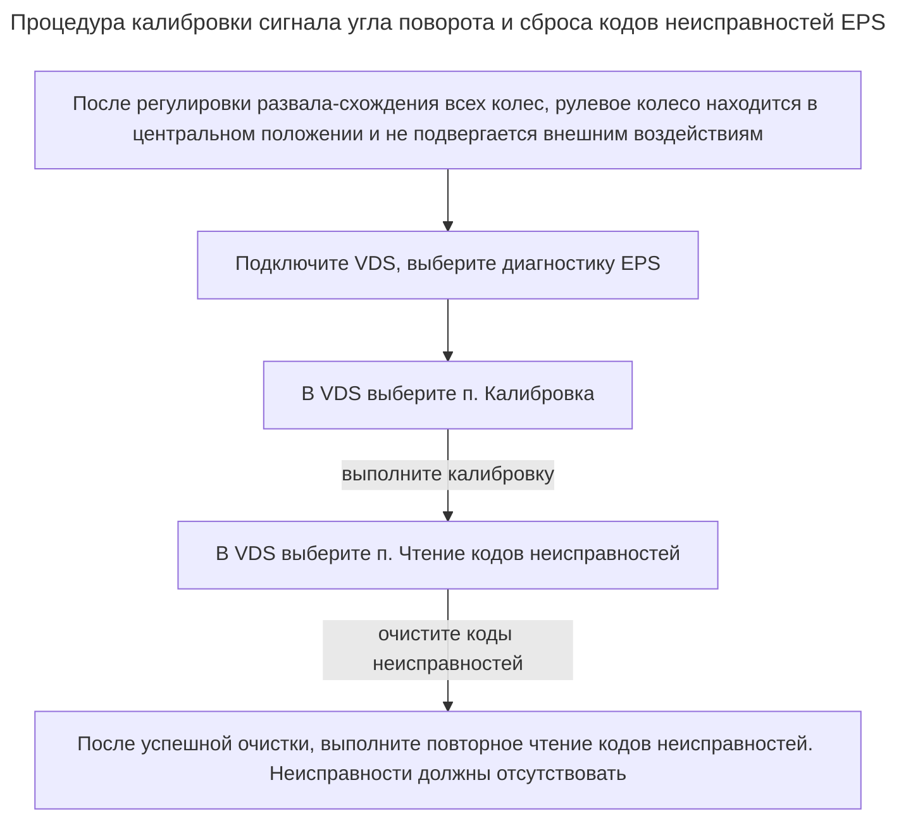
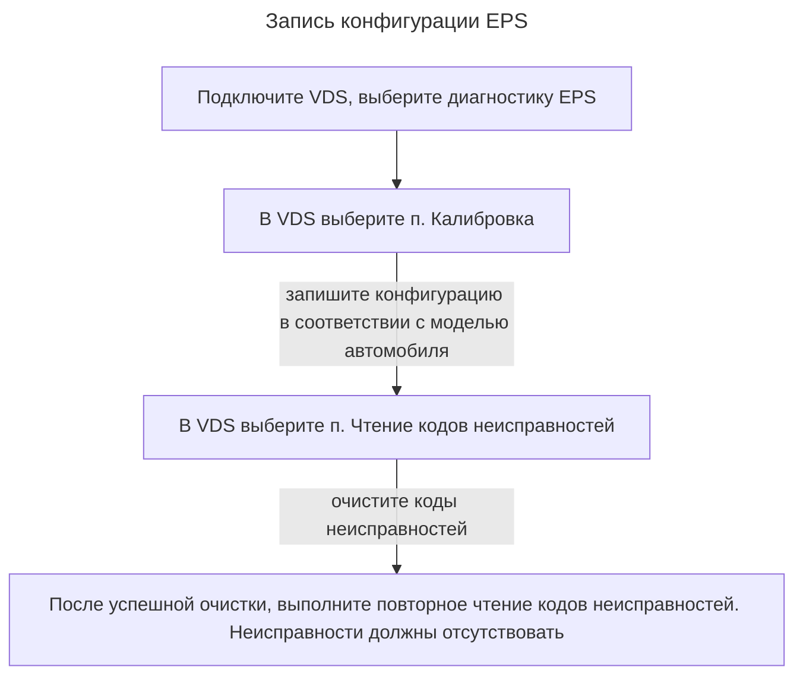

После разборки, замены рулевого колеса, рулевой колонки или рулевого механизма, либо после регулировки развала-схождения всех четырех колес, необходимо выполнить калибровку угла поворота руля.

Предварительные условия:

- Стандартное давление в шинах, автомобиль не быть перегруженным; автомобиль должен опираться на собственные колеса, в автомобиле не должно находиться никого или должен находиться только водитель;
- Перед началом калибровки автомобиль должен пройти регулировку развала-схождения всех четырех колес;
- Автомобиль не должен испытывать значительных вибраций, например таких, как при закрытии двери либо капота; также нельзя прикасаться к рулевому колесу руками или прилагать к нему усилие;
- Необходимо удостовериться, что механическое положение рулевого колеса находится в нулевой центральной точке;


Если автомобиль оснащен функцией дистанционного управления, во время калибровки сигналов поворота запрещено дистанционное управление, так как это может привести к серьезным повреждениям или неисправностям.


Значение датчика угла поворота рулевого колеса: после завершения калибровки в качестве стандарта следует использовать внутренний угол EPS, считанный диагностическим оборудованием, с диапазоном отклонения 0±3°.

После процедуры выключите и включите автомобиль и проверьте, нормально ли работает система EPS.

## Запись конфигурации EPS

После замены рулевого механизма, выполнения развала-схождения и калибровки углов поворота рулевого колеса автомобиля, необходимо перенастроить программное обеспечение системы рулевого управления автомобиля.

Для записи конфигурации необходимо получить доступ к соответствующему интерфейсу автомобиля в VDS и выбрать нужную конфигурации. Неправильный выбор конфигурации может привести к таким проблемам, как несовместимость функций оформления или тактильной обратной связи.

После процедуры выключите и включите автомобиль и проверьте, нормально ли работает система EPS.
